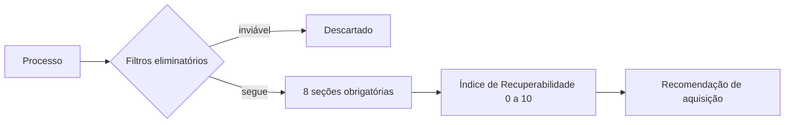

# JusReport

Metodologia padronizada de pré-auditoria para decidir a compra de créditos inadimplentes (NPL), que reduz cerca de 4 horas de trabalho manual por análise.

> **Confidencialidade:** esta ferramenta foi construída para uso interno de um escritório de advocacia. O código e os dados não são públicos. Este repositório documenta o problema, a solução e os resultados, sem nomes de clientes, partes ou processos.

## Problema

Cada análise de processo seguia um formato diferente. Comparar casos e decidir quais créditos comprar dependia de quem tinha feito a análise.

## Como funciona

- Relatório estruturado com 8 seções obrigatórias.
- Filtros eliminatórios que descartam cedo os casos inviáveis.
- Índice de Recuperabilidade de 0 a 10, que se converte em recomendação de aquisição.

## Ferramentas

IA generativa e desenho de processo.

## Resultados

- Redução de cerca de 4 horas de trabalho manual por análise.
- Em operação no escritório, não é um piloto.
- É a base que a [due diligence automatizada](https://github.com/yohannamunareto/due-diligence-npl-automatizada) executa em escala.
